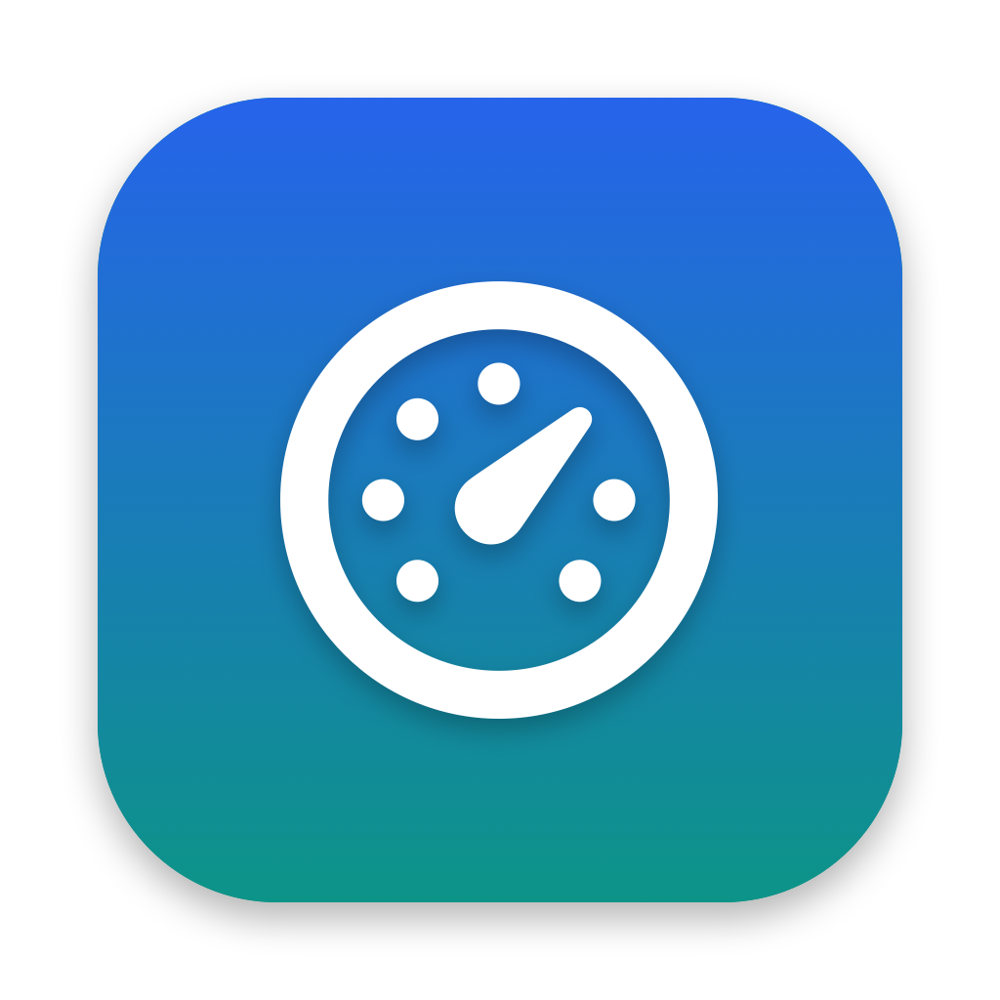
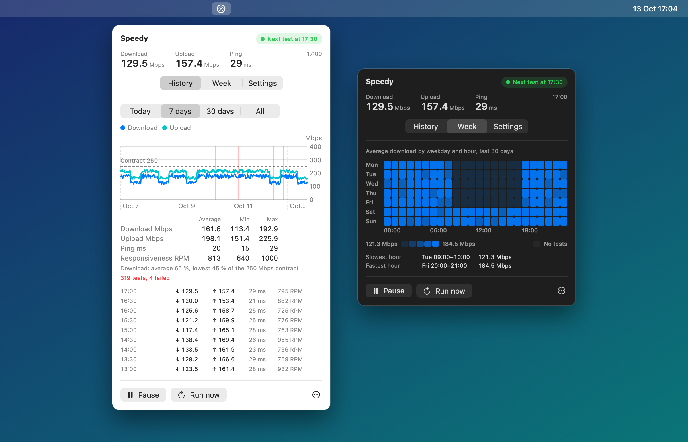
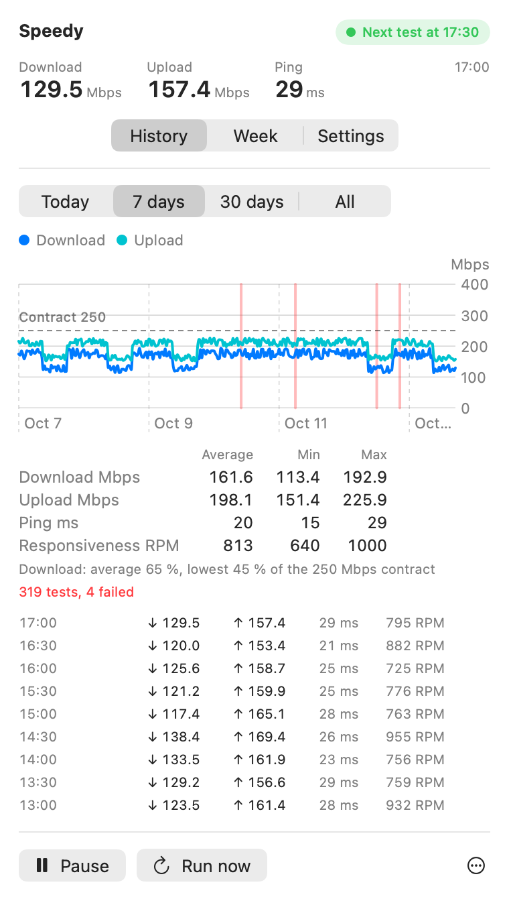
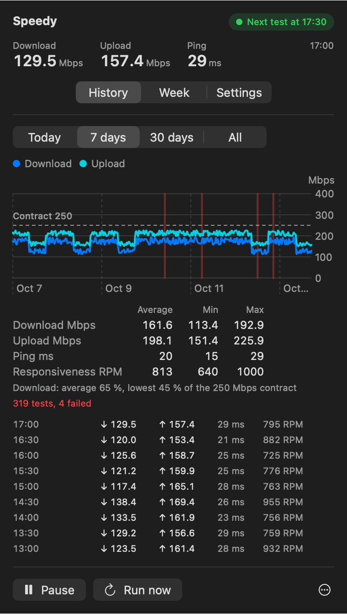
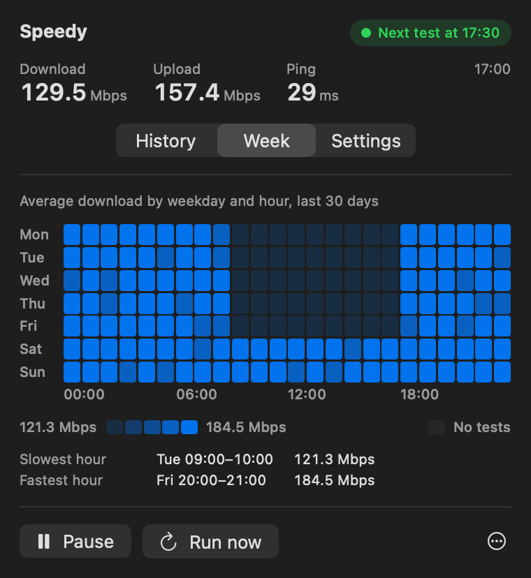
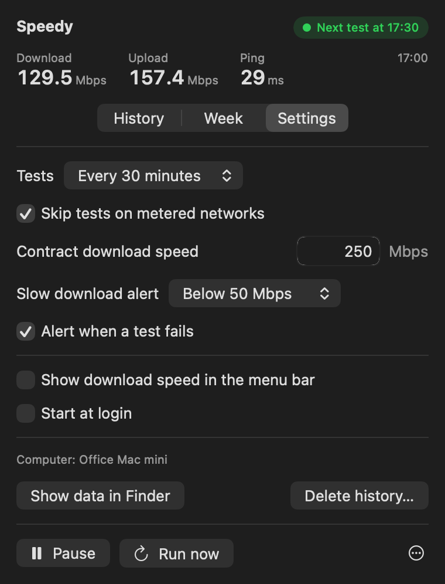
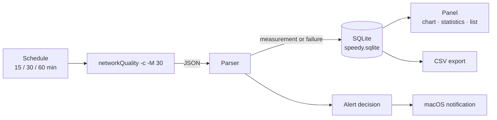

<p align="center">
  
</p>

<h1 align="center">Speedy</h1>

<p align="center">
  <b>A menu bar app for macOS that measures your internet speed on a schedule and keeps the history.</b>
</p>

<p align="center">
  <a href="https://github.com/ramenbox/speedy/actions/workflows/ci.yml"></a>
  
  
  
  <a href="LICENSE"></a>
</p>

<p align="center">
  <a href="#install"><b>Install</b></a> ·
  <a href="#usage"><b>Usage</b></a> ·
  <a href="#how-it-works"><b>How it works</b></a> ·
  <a href="#build-from-source"><b>Build from source</b></a> ·
  <a href="CHANGELOG.md"><b>Changelog</b></a>
</p>

<p align="center">
  
</p>

---

## Why Speedy

A single speed test tells you little. A slow line at 10:00 every weekday tells you a lot.
Speedy runs Apple's own `networkQuality` test at a fixed interval and stores every result.
One click on the menu bar icon shows the trend, the averages, and each failed test.

- **Apple's test, no third party.** Speedy calls `/usr/bin/networkQuality`, which is part of macOS. It uses no account, no tracking, no external speed test service.
- **No dependencies.** Plain Swift, SwiftUI, Swift Charts and the SQLite that ships with macOS.
- **Your data stays local.** Results live in one SQLite file on your Mac. Export them to CSV when you need them.

## Features

|  |  |
| --- | --- |
| 📈 **History in the menu bar** | Chart of download and upload for today, 7 days, 30 days, or all time. Failed tests show as red markers. |
| 📊 **Statistics** | Average, minimum and maximum of download, upload, ping and responsiveness for the selected range. |
| 🗓️ **Weekly pattern** | Average download for each weekday and hour of the last 30 days, with the slowest and fastest hour. |
| 📝 **Contract speed** | Enter the speed you pay for. The chart and the statistics compare each range with it. |
| ⏱️ **Schedule** | A test every 15, 30 or 60 minutes. Pause, resume, or run a test now. |
| 📱 **Metered networks** | Scheduled tests skip a metered network, for example an iPhone hotspot, and Low Data Mode. |
| 🔢 **Speed in the menu bar** | Optional: the last download speed next to the icon. |
| 🔔 **Alerts** | A notification when the download speed falls below your limit, or when a test fails. One alert per change, not one per test. |
| 📤 **CSV export** | Export today, 7 days, 30 days or everything to a CSV file for Numbers or Excel. |
| 🚀 **Start at login** | Uses the macOS login item service. |
| 🌗 **Light and dark mode** | Follows the system appearance. |

<table>
  <tr>
    <td align="center"><br /><sub>7 days, light</sub></td>
    <td align="center"><br /><sub>7 days, dark</sub></td>
    <td align="center"><br /><sub>Week</sub></td>
    <td align="center"><br /><sub>Settings</sub></td>
  </tr>
</table>

> The screenshots show demo data. `Tools/render-assets.sh` draws them from the real views.

## Install

1. Download `Speedy.zip` from the [latest release](https://github.com/ramenbox/speedy/releases/latest), or [build it yourself](#build-from-source).
2. Unzip it and move `Speedy.app` to the **Applications** folder. "Start at login" works only from there.
3. Open `Speedy.app`. A gauge icon shows in the menu bar and the first test starts.

> [!NOTE]
> The app has an ad-hoc signature and is not notarized. The first time macOS blocks it, open
> **System Settings → Privacy & Security**, scroll down and click **Open Anyway**. You do this one time.

**Requirements:** macOS 13 Ventura or later, on Apple silicon or Intel.

## Usage

Click the gauge icon in the menu bar. The panel shows:

- the status at the top right: the time of the next test, the running test with its elapsed time, a skipped test, **Paused**, or why tests stopped,
- the last result: download, upload and ping,
- the **History**, **Week** and **Settings** tabs.

The **History** tab shows the range picker, the chart, the statistics and the tests in the range, newest first.
The **Week** tab shows the average download for each weekday and hour of the last 30 days. Darker is faster. Hold the pointer over a cell to see its value.

The bar at the bottom has **Pause / Resume**, **Run now** and a **⋯** menu with **Export CSV** and **Quit Speedy** (⌘Q).

| Menu bar icon | State |
| --- | --- |
| Gauge | Tests are active. |
| Gauge with moving needle | A test is running. With "Reduce motion" on, the needle stays full. |
| Grey gauge | Tests are paused. |
| Warning triangle | Tests stopped because of a problem. The panel shows the problem and a **Try again** button. |

### Settings

| Setting | What it does |
| --- | --- |
| Tests | The interval between two tests: 15, 30 or 60 minutes. |
| Skip tests on metered networks | On by default. A scheduled test does not run on a network that macOS marks as metered or with Low Data Mode. **Run now** always runs. |
| Contract download speed | The download speed you pay for, in Mbps. Empty turns the comparison off. |
| Slow download alert | Off, or a notification below 10, 25, 50 or 100 Mbps. |
| Alert when a test fails | A notification when no test was possible, for example with no internet connection. |
| Show download speed in the menu bar | Shows the last download speed in Mbps next to the icon, or `–` after a failed test. |
| Start at login | Registers Speedy as a login item. |
| Show data in Finder | Opens the folder with the database. |
| Delete history | Removes all stored results after a confirmation. You cannot undo this. |

> [!TIP]
> Keep the lid open. A closed lid puts the Mac to sleep and stops the tests. While tests are active,
> Speedy prevents idle sleep.

> [!WARNING]
> Do not run Speedy on many Macs on the same line at the same time. Each test uses the full line for
> about 20 seconds, and tests that overlap lower each other's results.

## How it works



- **Test.** Speedy starts `networkQuality -c -M 30` and reads its JSON output. If the process does not end after 60 seconds, Speedy stops it, and kills it 5 seconds later if it is still running.
- **Failures.** A failed test is stored too, with a plain reason, for example `No internet connection` for `NSURLErrorDomain -1009`.
- **Storage.** One SQLite database, one row per test. A row with the same start time and computer is stored only once.
- **Alerts.** A notification is sent only when the state changes: the first slow test after a fast one, or the first failed test after a successful one.

### Where the data is

```
~/Library/Application Support/Speedy/speedy.sqlite
```

You can open the file with any SQLite tool, for example `sqlite3`.

### CSV columns

| Column | Meaning |
| --- | --- |
| `timestamp` | Date and time when the test started, in local time (`yyyy-MM-dd HH:mm:ss`). |
| `computer_name` | The Mac that ran the test. |
| `status` | `ok`, or `failed` when no test was possible. |
| `download_mbps` | Download speed in Mbit/s. |
| `upload_mbps` | Upload speed in Mbit/s. |
| `responsiveness_rpm` | Round trips per minute. Higher is better. Below 200 is low. |
| `base_rtt_ms` | Ping in milliseconds. Lower is better. |
| `interface_type` | `wifi`, `ethernet`, or both joined with `+`. |
| `interface_name` | The network port, for example `en0`. |
| `test_endpoint` | The Apple test server. |
| `error` | The reason when `status` is `failed`. |

## Build from source

You need the Xcode Command Line Tools (`xcode-select --install`). A full Xcode is not necessary.

```sh
git clone https://github.com/ramenbox/speedy.git
cd speedy
./checks.sh   # build and run the checks
./build.sh    # build build/Speedy.app and build/Speedy.zip (Apple silicon + Intel)
open build/Speedy.app
```

| Script | Output |
| --- | --- |
| `./build.sh` | `build/Speedy.app` and `build/Speedy.zip`, a universal binary with an ad-hoc signature. |
| `./checks.sh` | Builds and runs the checks for the parser, CSV, import, database, statistics and alerts. |
| `./Tools/render-assets.sh` | Draws `docs/images/*.png` and `Resources/AppIcon.icns` from demo data. |

> The Command Line Tools ship without XCTest, so the checks are a small program that exits with code 1 on a failure.

### Project layout

```
speedy/
├── Sources/
│   ├── Core/            Test runner, parser, SQLite store, CSV, statistics, alert rules (Foundation only)
│   └── App/             Menu bar item, model, notifications, login item, dialogs
│       └── Views/       SwiftUI panel: header, chart, statistics, settings
├── Checks/              Checks for the core logic
├── Tools/Assets/        Renders the icon and the screenshots
├── Resources/           AppIcon.icns
├── docs/images/         README images
├── build.sh
└── checks.sh
```

## License

[MIT](LICENSE) © Harun ([ramenbox](https://github.com/ramenbox))
